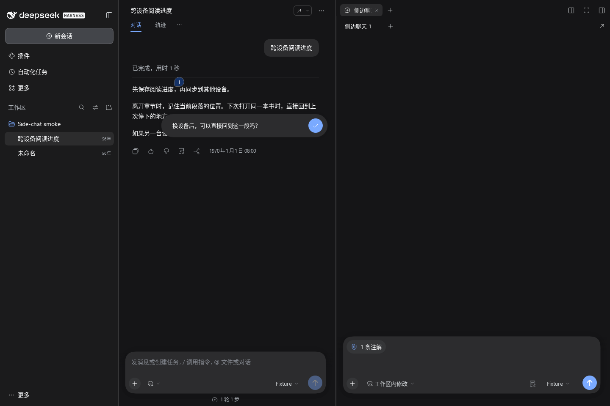
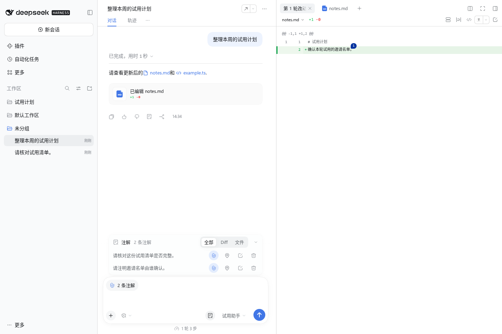
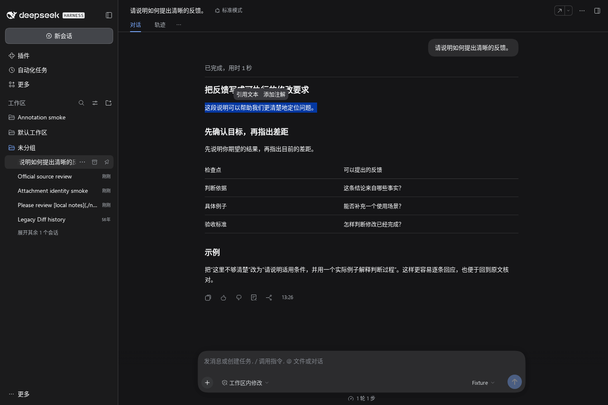
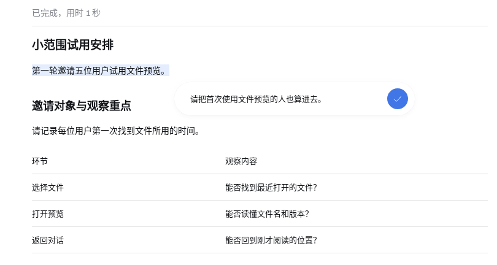
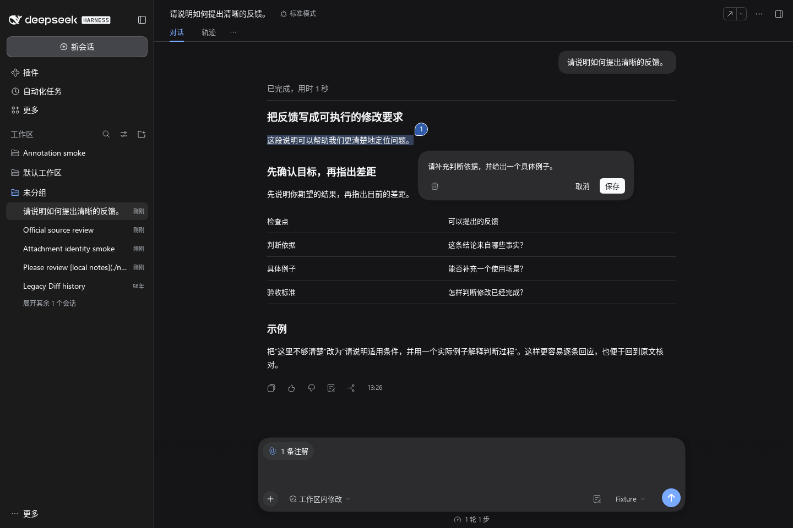
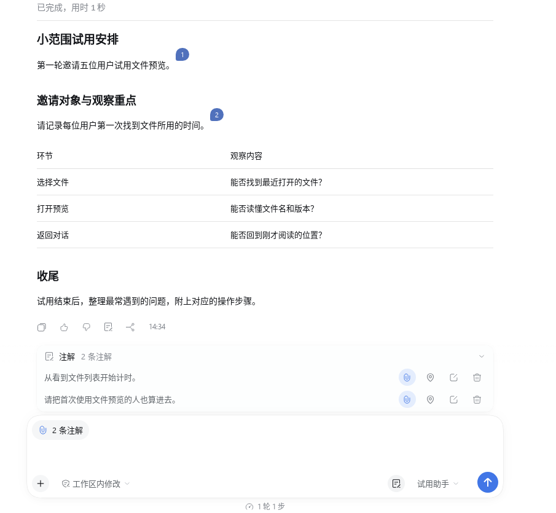
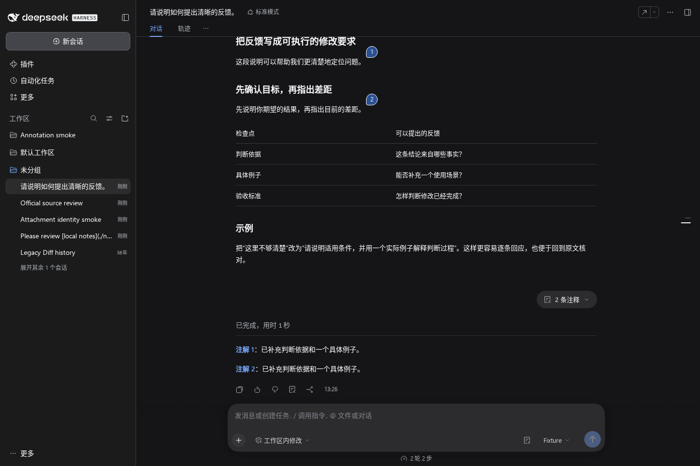
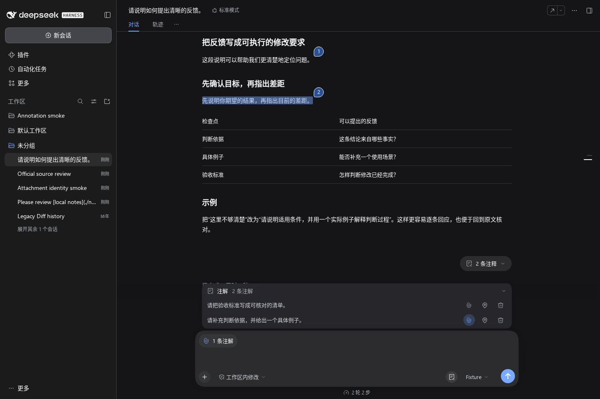
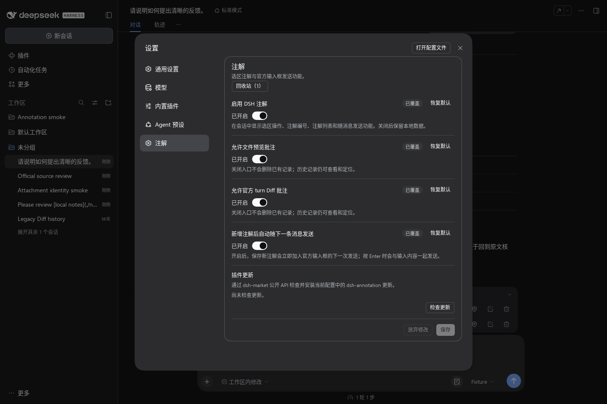

# DSH 注解

简体中文 · [English](README.en.md)

## 概览

在主会话或侧栏选中文字即可添加注解，编辑框跟随原文。也可以标注文件和代码差异，将多条注解随消息发送，再从注解记录跳回出处。每个会话都有自己的记录框，集中显示注解及本次附加选择。插件通过官方输入框一起发送注解、文字、图片和文件；未发送内容保存在当前浏览器中。

**1.2.0 要求 DSH `>=0.2.2-rc.1`，验证基线为 master 提交 `fcc0ad4621`。** 旧宿主更新前请先看[升级说明](#upgrading)。

[下载交互原型](https://github.com/ruisenbai/dsh-annotation/releases/download/v1.2.0/dsh-annotation-ui.html)，用浏览器打开即可试用 5 个场景、42 种组件状态。示例数据不会写入你的聊天。



## 目录

- [安装与升级](#installation)
- [支持的来源](#sources)
- [新建与编辑](#editing)
- [记录与附加](#records)
- [侧边聊天](#side-chat)
- [发送、重发与重试](#sending)
- [删除与恢复](#recovery)
- [设置](#settings)
- [数据与限制](#limitations)
- [模型如何处理注解](#model-experience)
- [开发参考](#development)

<a id="installation"></a>

## 安装与升级

发行包通过 [GitHub Releases](https://github.com/ruisenbai/dsh-annotation/releases/tag/v1.2.0) 分发，不发布到 npm。在 **插件 → 插件市场**（较早的界面位于 **设置 → 插件市场**）的“会话与消息”分类中找到 `ruisenbai/dsh-annotation`，即可安装或更新。市场使用发行版的固定文件名下载地址；操作前请确认显示的插件版本及宿主要求。

### 手动安装

桌面版可在插件市场搜索 `ruisenbai/dsh-annotation` 并安装。手动安装时，下面的 `web` 代表网页版配置，桌面版请把命令中的两处 `web` 改成 `desktop`。两个配置独立，使用哪个就安装到哪个：

```bash
dsh --version
dsh plugin --profile web add https://github.com/ruisenbai/dsh-annotation/releases/download/v1.2.0/dsh-annotation.tgz
dsh plugin --profile web why dsh-annotation
```

宿主必须满足 `>=0.2.2-rc.1`，最后一条命令应解析到 `dsh-annotation@1.2.0`。使用自定义 profile 时，将两处 `web` 改为实际名称。安装后重新打开对应的桌面应用，或重启 Web 服务并刷新页面，然后在 **设置 → 注解** 中确认插件可用。构建方法和实际验证结果见[开发说明](docs/development.md)及[兼容性说明](docs/compatibility.md)。

启用 [Codex UI](https://github.com/MichengAI/dsh-codex-ui) 时，注解插件会自动开启兼容模式，避免已附加的注解遮挡输入文字。无需手动设置；停用 Codex UI 后恢复标准布局。详见 [Codex UI 兼容说明](docs/compatibility.md#codex-ui)。

注解控件跟随宿主的主题、圆角和面板样式。选区操作栏、注解编辑窗、详情和附件预览的字体比对话正文小 1px；普通文字提示保持原字号。新注解编辑窗上下留白为 10px，文本框随字号和内容增高，最多显示七行。附加注解的预览保持在窗口内；记录面板较窄时，操作按钮会排到注解文字下方。

### 交给 AI 助手安装

将下面的提示词交给能够操作本机终端的助手：

```text
将 dsh-annotation 1.2.0 安装到我的 DeepSeek Harness。默认使用 web 配置；如果我指定桌面版就使用 desktop。先运行 dsh --version，确认宿主满足 >=0.2.2-rc.1，再用 dsh plugin --profile <配置名> add 安装 https://github.com/ruisenbai/dsh-annotation/releases/download/v1.2.0/dsh-annotation.tgz。用 dsh plugin --profile <配置名> why dsh-annotation 核对版本。保留现有会话、设置与浏览器数据，告诉我实际结果以及如何让更新生效。
```

<a id="upgrading"></a>

### 从旧宿主升级

先将宿主更新到 `0.2.2-rc.1` 或更新版本，再安装 1.2.0。受支持的宿主版本提供统一的“引用文本 / 添加注解”操作栏。使用 `0.2.2-alpha.3` 时保留 1.1.7；使用 `0.2.2-alpha.2` 时保留 1.1.6；使用 `0.2.1-rc.2` 时保留 1.1.5；仍使用 `0.2.1-alpha.2` 时，请保留插件 1.1.2；使用 `0.2.1-alpha.1` 时保留 1.1.1，使用 `0.2.0` 系列宿主时保留 1.1.0。请同时更新宿主端插件与网页客户端，无需清空浏览器数据。旧记录仍可读取；新保存的记录使用注解协议 v6、本地存储 v7，旧版插件不能读取。详见[侧边注解迁移指南](docs/upgrade-guide/v1.1.8/side-annotations/guide.zh.md)。[宿主升级指南](docs/upgrade-guide/v1.1.8/host-baseline/guide.zh.md)列出了版本检查方法。

<a id="sources"></a>

## 支持的来源

根据要批注的内容，打开对应的官方预览或侧栏：

| 来源                                                 | 添加方式                                                         | 定位方式                             |
| ---------------------------------------------------- | ---------------------------------------------------------------- | ------------------------------------ |
| 助手回复                                             | 在同一条回复中选中文字，点击 **添加注解**                        | 点击气泡或记录行的定位图标返回原文   |
| 官方文本、代码或 Markdown 文件预览                   | 选中片段，或点击 **批注此来源** 添加整文件意见                   | 打开官方预览并定位保存的选区         |
| 官方 HTML、图片、PDF、Office、Excel、CSV 或 TSV 预览 | 使用整文件批注；渲染文本选区仅在文本、代码和 Markdown 预览中提供 | 保留官方资源标识及预览版本           |
| 官方 turn Diff                                       | 从本轮变更文件卡片打开 Diff 侧栏，选中片段或批注整个文件         | 打开对应的官方 Diff 审阅及保存的注解 |
| 历史 Git Diff                                        | 查看已有记录和保存的上下文                                       | 只读，不支持新增、编辑、附加或重试   |



整文件批注必须填写意见。官方 Diff 的悬浮预览不提供新增入口，请使用侧栏。当前会话包含至少两种来源时，记录框会显示来源筛选。文件和 Diff 注解保留来源标识、选区坐标和引用上下文；暂时加载失败或定位失败不会删除已保存的记录。

<a id="editing"></a>

## 新建与编辑

1. 选中原文并点击 **添加注解**。回复正文只显示一个操作栏，包含 **引用文本** 和 **添加注解**：引用会将片段插入主输入框，添加注解会打开注解编辑器。网页链接和本地文件链接的文字可以单独拖选，也可以连同前后的正文一起选中；普通单击仍会打开链接目标。重叠选区会创建独立注解。
2. 在选区下方输入意见。按 Enter 或点击对号保存，Shift+Enter 换行；中文输入法组词期间不会提前保存。输入区从一行自动增高，最多显示七行，超过后在内部滚动。
3. 主动保存空的选区注解，可以只标记原文。新建编辑框为空时，前两次点击外部会轻微晃动，第三次取消；在主输入框开始输入也会取消空白新注解。取消不会产生记录、气泡、附加项或回收站内容。新建内容非空时，第三次点击外部会保存。
4. 点击数字气泡打开注解。草稿可以编辑；已发送注解显示保存的内容，并可再次附加。取消编辑会保留原先保存的注解，暂存的未完成修改不会随消息发送。

每条已保存的注解、原文标记和侧边聊天引用都有紧贴选区最后一个可见字符右上角的蓝色半透明气泡，左下角保留指向原文的小尾角。选择方向和尾部空白不改变锚点。气泡跟随原文字号，保留独立点击区域，向右排列，拥挤时局部换行或避让，不挤占正文宽度。同一行后面仍有正文时，第一枚气泡也保持在这个角落。可见气泡和白色编号随正文字号变化，保留独立且宽裕的点击区域。蓝色磨砂表面适配深浅主题，不支持背景模糊时仍保留半透明底色。悬浮、键盘聚焦或打开记录时，蓝色底色变为不透明，编号始终清晰；离开后恢复半透明。悬浮或聚焦气泡时预览对应原文，点击直接打开该记录。选区确认按钮采用主发送按钮的蓝色圆形样式。输入区注解和引用的操作按钮在悬浮或键盘聚焦时平滑展开；触屏保持可见，减少动态效果时取消过渡。







<a id="records"></a>

## 记录与附加

新注解默认附加到下一条消息，不会自动展开记录框。输入框左上角显示附加数量，悬浮可预览原文和意见，点击可展开或折叠记录。模型选择按钮左侧的注解按钮也能打开或关闭记录框。没有注解的新会话不会显示空记录框。

每条记录显示填写的意见；仅标记原文的注解显示原文摘要。记录提供回形针附加或取消附加、定位图标跳转来源、草稿编辑，以及发送状态未锁定时的删除操作。悬浮记录文字可在记录框上方查看引用、来源类型、创建入口和保存的上下文，不会遮挡各行操作。附加数量提示在悬浮或键盘聚焦时还会显示批量取消附加和删除操作。取消附加会保留注解，删除则移入回收站。

记录框只显示注解总数，所有记录使用相同的附加操作，不显示发送状态文字或状态圆点。全部注解按创建时间从新到旧排列，重新打开列表或切换 **全部 / 正文 / Diff / 文件** 筛选时保持同一规则。附加或取消附加不会改变行位置。编辑不改变创建顺序；来源气泡编号、实际提交顺序和已固定的重试内容不受列表排序影响。



<a id="side-chat"></a>

## 侧边聊天

右侧边栏 **侧边聊天** 入口中的 **＋** 会打开一段独立的普通对话。聊天名称由外层标签栏显示，内容区和输入框沿用普通对话布局。在主对话回复中选择文字，点击 **在侧边添加注解**，即可在所选原文旁打开紧凑注解编辑器，并保存到当前侧边聊天；文字输入区和蓝色对号按钮与主会话相同。没有侧边聊天时会自动创建。保存只生成注解，通过输入框发送后才会请求模型。

主对话和侧边聊天共用注解记录、附加、定位原文、再次发送和回收站功能。每个侧边聊天独立保存注解和未完成的编辑；切换标签会隐藏编辑器并保留该聊天的未完成内容，主对话的草稿和附件也会保留。点击原文气泡会打开接收聊天中的对应注解，并在卡片可见时保持激活；再次点击已发送注解的气泡可收起卡片。点击 **定位原文** 可返回原来的文字。在侧边回复中选中文字，使用 **添加注解** 即可继续在该聊天中注解。首次添加和再次点击来源气泡时，编辑器都在原文旁浮动显示，包括另一可见会话中的原文。只有原文不可见或未加载时，才显示在接收聊天的输入框上方。侧边聊天单独打开为完整页面时也使用相同定位规则。在这个主页面中，选中文字也可使用 **在侧边添加注解**，保存到该页面自己的接收聊天，原有关联保持不变。

未命名聊天有各自保存的名称，刷新或移除其他聊天后保持不变；手动设置的会话标题会实时更新。自动标题含有注解请求头时，侧边标签沿用保存的聊天名称。标签标题沿用官方渐隐效果，悬浮或键盘聚焦可查看完整标题。悬浮或聚焦标签可归档、删除对应聊天，触屏始终显示这些操作。归档保留关联和数据，可从官方已归档会话列表恢复原聊天；删除沿用官方确认，并移除该聊天的本地关联和注解。移除当前标签后先选择右侧相邻标签，再选择左侧；移除最后一个标签后显示新建入口。切换标签或隐藏侧栏不会中断其他聊天的生成。标签上的归档和永久删除按钮需要[提供相应接口的宿主构建](docs/compatibility.md#side-chat-host-build)。

升级后，尚未发送的侧边引用会转为只含原文、尚未填写意见的注解。转换先保存注解，再移除旧引用；中断后可重试，不会重复生成。已冻结的重试请求和发送结果未知的请求保留原始内容，已发送的历史仍可查看。宿主和客户端插件应使用匹配构建，具体步骤见[升级指南](docs/upgrade-guide/v1.1.8/side-annotations/guide.zh.md)。

注解和侧边聊天关联保存在当前浏览器站点内。保存失败时会保留可恢复数据并提示错误。完整刷新后，未发送的附件需要重新选择。详见[本地恢复](docs/data-model.md#side-chat-data)。

<a id="sending"></a>

## 发送、重发与重试

通过官方输入框，将已附加注解与可选的文字、图片和文件一起发送。普通斜杠命令仍按原有方式执行。宿主检查或发送消息期间，附加和编辑操作保持锁定，直到本次处理结束。发送后的用户消息正文上方显示注解数量：单条可悬浮预览、双击定位；多条可展开后逐条查看和定位。全部注解已发送且没有附加项时，记录框自动关闭。

发送后，仍可通过同一个回形针按钮重新附加可用的注解。注解 ID 和来源气泡保持不变，也不会新增重复记录。模型回答中的“注解 1”等链接显示为蓝色加粗文字，不带下划线；悬浮可预览注解，点击可定位原文。

发送失败后，通过输入框再次发送可重试保存的批次，也可在记录框中选择 **放弃**，取消该次重试。重试保留原来的注解、整体要求、语言、目标会话和附件顺序。刷新后如提示需要附件，请重新选择原附件；附件身份不一致时会拒绝发送。后续编辑和选择不会悄悄替换原批次，已经排队或被接收的提交也不会因过期的重试操作而重复发送。





<a id="recovery"></a>

## 删除与恢复

删除单条记录，或通过附加数量提示批量删除，会将注解移入当前浏览器的回收站。删除成功后可撤销。正在发送或被重试批次锁定的注解，需要先解除对应操作才能删除，界面会说明原因。删除已发送记录不会改写原会话消息。

在 **设置 → 注解 → 回收站** 中，可按会话和来源类型筛选，查看保存的引用与意见，并恢复记录。宿主提供会话资料时，列表会显示项目名和会话标题。已捕获的来源快照可以预览，保存的文件可以下载；完整来源不可用时，仅在回收站详情中显示状态，已保存的引用片段仍可使用。永久删除和清空回收站需要确认，操作只移除本地回收站内容，不删除已发送的会话消息。

<a id="settings"></a>

## 设置

**设置 → 注解** 提供四个开关，默认全部启用：

| 设置                | 作用                                                 |
| ------------------- | ---------------------------------------------------- |
| 启用注解            | 显示注解界面并接入输入框；停用后保留本地数据         |
| 文件预览批注        | 允许从官方文件预览创建批注                           |
| 官方 turn-Diff 批注 | 允许从官方 Diff 侧栏创建批注                         |
| 自动附加新注解      | 保存新注解后附加到下一条消息；关闭时可手动使用回形针 |

修改后需要点击 **保存** 才会生效。**放弃** 会取消未保存的设置，**重置** 会将已覆盖的字段恢复为继承值或默认值。关闭某类来源入口仍会保留已有记录。历史版本的紧凑汇总和会话内容隐藏设置不再提供操作入口，也不会影响当前界面。

dsh-market 提供公开更新 API 时，同一设置卡片可检查、安装本插件更新并显示进度。只有符合条件的发布策略错误才会提供强制更新；回退、刷新页面和重启宿主取决于市场返回的能力。没有该 API 时，请使用 **设置 → 插件市场**。更新请求不包含注解内容。



<a id="limitations"></a>

## 数据与限制

- 未发送草稿、暂存编辑、重试、回收站内容和来源快照保存在当前浏览器，不跨浏览器同步；清理站点数据可能将其删除。已发送的注解记录可从会话历史恢复。
- 多标签页会协调本地写入并保留冲突修改。遇到损坏或未来版本的数据时，会保留原数据并报错，不以空状态覆盖。
- 选区不能跨助手消息。Markdown、代码和表格的定位依赖宿主渲染内容及可用历史。插件不会隐藏思考、工具调用或其他会话内容。
- 整文件批注必须填写意见，较长选区需要确认。默认每批最多发送 100 条注解，编码后的载荷最多 512 KiB，可通过 profile 配置调整。
- 已归档会话没有可用的输入框，请在可编辑的会话中创建并附加注解。
- 历史 Git Diff 记录保持只读。浏览器数据迁移不会改写已提交的历史协议或会话消息。
- 已验证的浏览器环境为 Chromium 中的 DSH Web。其他浏览器、操作系统、未来宿主版本及可选第三方插件组合需要单独验证。

本地数据和网络请求见[隐私说明](docs/privacy.md)，持久化及重试规则见[数据模型](docs/data-model.md)。

<a id="model-experience"></a>

## 模型如何处理注解

输入框将选中的注解作为一条用户消息发送，包含各条引用、意见、来源标识和可选的整体要求。当前界面要求模型按顺序回答注解；只标记原文的注解没有文字意见。本地完整来源快照不会自动加入模型请求。

未发送的注解不增加模型上下文。每批共用精简的处理说明，并省略不适用的段落；将相关注解合并发送可以分摊这部分固定开销。已提交的文字和隐藏标记在保留于模型历史期间会占用上下文。[消息格式](docs/architecture.md#durable-representation)说明了保留的字段和按需附带的指令。

模型回复中的隐藏关联和完成标记用于将回答对应到原文，并识别已处理注解。界面隐藏这些标记，会话日志仍保留它们。确认标记缺失或无效时，记录不会变为已处理；发送成功本身不等于模型已确认。

<a id="development"></a>

## 开发参考

<details>
<summary>配置与实现</summary>

[安装补丁](cordis.patch.yml)插入一个 `dsh-annotation` 条目，接入宿主命令与 Web 客户端。profile 配置可调整 `commandName`、`maxPayloadBytes`、`maxAnnotationsPerSubmission`、`warnSelectionChars` 和 `locateHistoryPages`；四个用户开关通过宿主设置编辑。[架构说明](docs/architecture.md)集中介绍接入方式和配置。

[开发说明](docs/development.md)包含构建、发行包验证、真实 Web profile 检查和记录性能测量；[兼容性说明](docs/compatibility.md)记录精确宿主基线及已执行的验证；[发布说明](RELEASING.md)介绍 GitHub 发行包和市场目录更新。

</details>

[贡献指南](CONTRIBUTING.md) · [更新记录](CHANGELOG.md) · [许可证](LICENSE)

### 开发备注

无。
